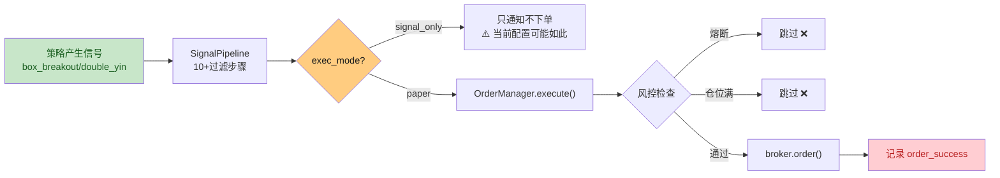

# 实盘交易改造方案

> 基于多专家视角全面审查后制定的真实交易场景落地计划
> 日期：2026-07-15

---

## 一、现状审查结论

经过数据工程师、量化策略分析师、风控总监、系统架构师、用户体验设计师、实盘交易员六位专家视角审查，核心问题集中在：

| # | 问题 | 严重度 |
|---|------|--------|
| 1 | **信号不执行**：14条历史信号全部 order_success=null，未实际下单 | P0 |
| 2 | **通知过载**：日均21-35张飞书卡片，用户无法消化 | P0 |
| 3 | **策略有效性不足**：16个策略仅2个有效，信号密度极低 | P1 |
| 4 | **数据层P0缺陷**：`cache().clear()` 雪崩、无IP代理轮换 | P1 |
| 5 | **双进程状态文件竞态**：引擎和Web进程写入同一JSON无锁 | P1 |
| 6 | **QMT实盘未实现**：所有方法均为stub | P2（先跑模拟盘） |

---

## 二、目标与路线

**目标**：让 gugu 完成完整的交易闭环——信号产生 → 下单执行 → 持仓管理 → 止损止盈 → 再入场

**路线**：先瘦身跑通模拟盘，验证稳定后再上实盘

---

## 三、实施计划（详细）

### 阶段A：诊断信号执行链路（立即执行）

#### A1 问题定位
当前系统默认 `exec_mode: paper`，但信号并未执行。需要逐环检查：



**检查项**：
1. 当前 `settings.yaml` 中 `execution.mode` 是什么？`signal_only` 还是 `paper`？
2. `main.py:run_daily_cycle()` 中 `_process_signal()` 的 paper 分支是否被触发？
3. `OrderManager.execute()` 中是否有风控/仓位限制导致所有信号被跳过？
4. `broker.order()` 返回的 `order_success` 为什么是 null？

#### A2 修复方案
- 如果当前是 `signal_only` → 改为 `paper`
- 如果风控挡住了 → 调整参数（降低熔断门槛、增加仓位上限）
- 如果 `order_success` 没记录 → 修复记录逻辑

---

### 阶段B：通知精简

目标：日均21-35张 → 5-8张

#### B1 关闭噪声模块（配置文件修改）

```yaml
scheduler:
  tasks:
    perspective_daily: false    # 关闭十大视角每日推送（省10+张）
    macro_morning: true         # 保留宏观简报
    macro_premarket: false      # 关闭盘前宏观简报（已合并）
    macro_noon: false           # 关闭午间宏观简报
    macro_close: true           # 保留收盘宏观概览
    concept_daily: false        # 已关闭（每日概念）
    alpha_summary: false        # 关闭因子评分报告
    sentiment_daily: false      # 关闭舆情日报
    market_temp: true           # 保留温度计
    perspective_afternoon: false # 关闭收盘二次分析
    signal_morning: true        # 保留盘前信号
    signal_noon: true           # 保留午盘信号
    signal_close: true          # 保留收盘信号
    flow_afternoon: false       # 关闭资金流报告
```

保留的推送（5-7张/天）：
- 08:00 宏观早报
- 08:25 市场温度计
- 09:10 盘前信号汇总
- 11:35 午盘信号汇总
- 14:30 盘中扫描信号（聚合）
- 15:10 收盘信号汇总
- 15:15 收盘宏观概览

#### B2 盘中告警聚合（代码修改）

`intraday_monitor.py`：当前每分钟扫描，有异动就推送。改为每30分钟聚合一次，只推送摘要。

---

### 阶段C：打通信号执行链路（核心）

#### C1 降低过滤链门槛

`signal_pipeline.py` 中过滤链过长，需要在 paper 模式下允许更多信号通过：

| 过滤步骤 | 当前行为 | 修改后（paper模式） |
|---------|---------|-----------------|
| 基本面过滤 | 数据不足时拒绝 | 数据不足时放行（有ETF持仓） |
| 资金流过滤 | 数据源降级时拒绝 | 数据不足时放行 |
| 板块轮动检查 | 非热板时拒绝 | 改为警告，不拒绝 |
| Wisdom LLM | 超时时 wisdom_filtered=True | 超时时走硬编码fallback |
| 四阶段入场过滤 | FRENZY/FINAL拒绝 | 保持（安全保护） |

#### C2 修复 order_success 记录

追踪 `main.py:OrderManager.execute()` 中 `result.success` 的赋值逻辑，确保 paper 模式每笔订单都正确记录。

#### C3 增加执行日志

在 `OrderManager.execute()` 和 `PaperBroker.order()` 中加入结构化日志，格式：
```
[TRADE] 模式=paper | 股票=600276 | 方向=buy | 价格=42.50 | 数量=200 | 结果=success | 资金=991234.56
```

---

### 阶段D：数据层P0修复

#### D1 修复缓存雪崩

`data/manager.py:272`：`cache().clear()` → 改为只清理当前失败请求的缓存条目。

#### D2 默认启用第二降级源

`config/settings.yaml`：
```yaml
data:
  primary_source: sina
  fallback_sources: ["akshare", "eastmoney"]
```

---

### 阶段E：双进程文件锁（安全加固）

`execution/paper.py` 的 `_save_state()` 和 `_load_state()` 中加入 `portalocker` 文件锁互斥。

---

## 四、验收标准

| 阶段 | 验收条件 |
|------|---------|
| A-诊断 | 明确知道信号为什么不执行（日志可追溯） |
| B-通知精简 | 运行一个交易日，飞书卡片≤8张 |
| C-信号执行 | 产生信号的股票，持仓数量有变化，`order_success=True` |
| D-数据修复 | 数据源降级时不全局清空缓存，降级链路正常 |
| E-文件锁 | 引擎和Web同时运行时，状态文件不出现覆盖写入 |

---

## 五、不做的范围

- ❌ 不新增策略（保持现有 box_breakout + double_yin）
- ❌ 不实现 QMT 实盘（等模拟盘跑通后再做）
- ❌ 不重构代码架构（只做针对性修复）
- ❌ 不新增通知类型（只减少）
- ❌ 不改动风控核心逻辑（止损、熔断、仓位控制保持）